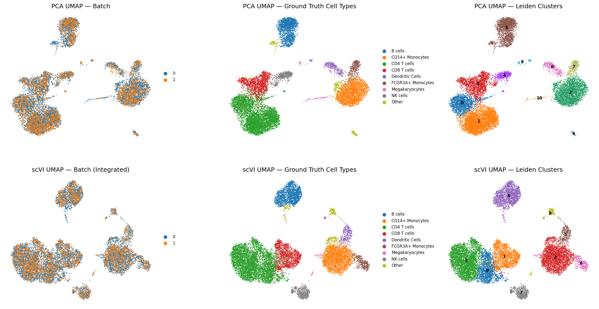
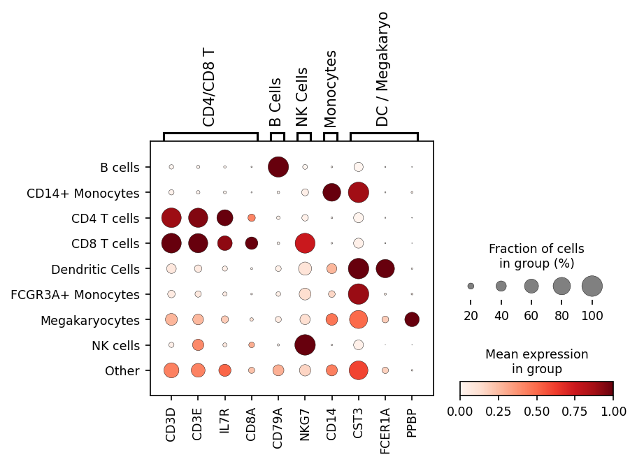
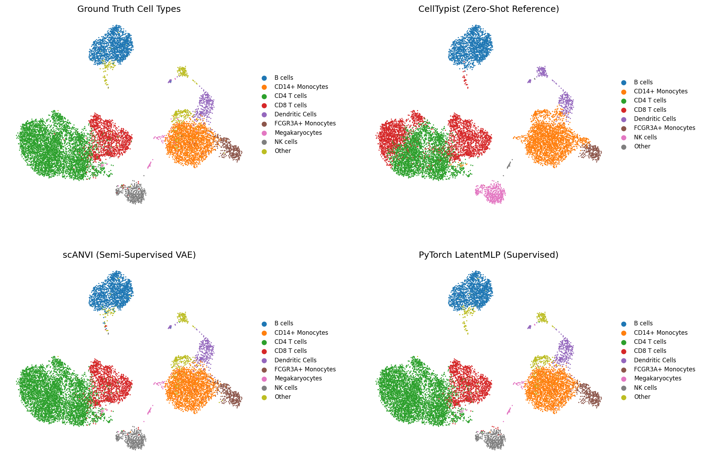
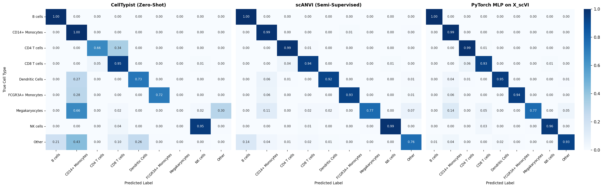
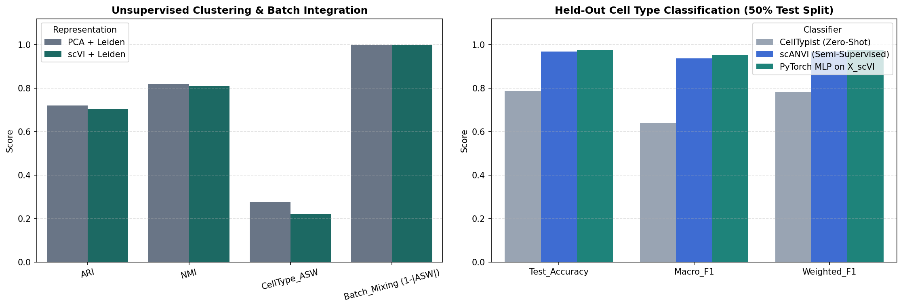

# Single-Cell RNA-seq Cell Type Classification & Multi-Batch Clustering


An end-to-end computational genomics pipeline for **multi-batch single-cell RNA-seq (scRNA-seq) preprocessing, deep generative batch integration, unsupervised clustering, and three-way cell-type classification**—engineered to run cleanly within a **4 GB VRAM budget** on an NVIDIA RTX 2050 Laptop GPU.

---

## Overview

Single-cell transcriptomics across independent sequencing runs introduces strong technical batch effects alongside sparse count distributions and cell doublets. This project benchmarks classical linear workflows against deep variational autoencoders and pretrained immune atlases on **12,039 human Peripheral Blood Mononuclear Cells (PBMCs)** pooled from two 10x Genomics batches (`pbmc8k` and `pbmc4k`):

1. **Quality Control & Doublet Removal (`preprocess.py`):** Filters low-complexity and high-mitochondrial cells, removes batch-specific doublets via `Scrublet`, normalizes counts (`1e4` + `log1p`), selects 2,000 batch-aware Highly Variable Genes (HVGs), and establishes an unsupervised `PCA → KNN → UMAP → Leiden` baseline.
2. **Deep Generative Batch Integration & Classification (`models.py`):**
   - **`scVI` (Variational Autoencoder):** Models raw integer UMI counts with a Negative Binomial likelihood to learn a batch-corrected 10-D latent manifold (`X_scVI`).
   - **`CellTypist` (Zero-Shot Reference):** Maps full log-normalized transcriptomes onto the `Immune_All_Low.pkl` reference atlas with local subcluster majority voting.
   - **`scANVI` (Semi-Supervised VAE):** Fine-tunes pretrained `scVI` weights when 50% of cell labels are masked as `"Unknown"` to propagate annotations across unlabeled cells.
   - **`LatentMLP` (Supervised PyTorch Classifier):** Trains a compact 2-layer neural network (`10 → 64 → 8`) directly on `X_scVI` embeddings using the labeled 50% split.
3. **Quantitative Benchmarking & Visualization (`evaluate.py`):** Evaluates clustering fidelity (`ARI`, `NMI`, `CellType_ASW`, `Batch_Mixing`) and held-out classification generalization (`Accuracy`, `Macro-F1`, `Weighted-F1`), exporting CSV tables and publication-grade figures.

---

## Pipeline Architecture

```text
scvi.data.pbmc_dataset (12,039 cells x 3,346 genes, 2 batches)
       │
       ▼
[1. preprocess.py] ──► QC Filter (genes > 200, MT < 15%) ──► Scrublet Doublet Removal
       │                                                         │
       ├──► adata.raw (Full log1p-normalized transcriptome) ───────┼──► CellTypist (Zero-Shot)
       ├──► Top 2,000 Batch-Aware HVGs ──► PCA (30 PCs) + Leiden │
       └──► adata.layers["counts"] (Raw Integer UMIs)            │
                 │                                               │
                 ▼                                               │
[2. models.py] ──► scVI VAE (n_latent=10, NB likelihood) ────────┤
                 │                                               │
                 ├──► X_scVI + Leiden Clustering                 │
                 ├──► scANVI Fine-Tune (50% Labeled / 50% Test) ─┤
                 └──► PyTorch LatentMLP (50% Labeled / 50% Test) ┘
                                                                 │
                                                                 ▼
[3. evaluate.py] ──► results/*.csv + figures/*.png (UMAPs, Dotplot, Confusion Matrices)
```

---

## Results & Visualizations

### 1. Batch Integration & Unsupervised Clustering (`PCA` vs. `scVI`)

In standard Euclidean `PCA` space, cells separate partially by sequencing batch (`pbmc8k` vs. `pbmc4k`). Conditioning the `scVI` variational autoencoder on `batch` collapses technical batch separation while preserving crisp biological boundaries across all 8 PBMC populations.



- **Top Row (`PCA + Leiden`):** Shows residual batch stratification between `pbmc8k` and `pbmc4k` within major T-cell and monocyte islands.
- **Bottom Row (`scVI + Leiden`):** Demonstrates uniform batch mixing across every manifold island alongside clean separation of B cells, NK cells, Monocytes, Dendritic Cells, Megakaryocytes, and T-cell subsets.
- **Metrics CSV:** [`results/clustering_benchmark.csv`](/Source/results/clustering_benchmark.csv)

---

### 2. Canonical PBMC Lineagce Marker Validation

To confirm that computational clusters correspond to true hematopoietic cell identities, expression of canonical lineage markers is evaluated across the normalized transcriptome (`adata.raw`):



- **T-Cell Lineages:** Pan-T marker *CD3D*/*CD3E*, helper T marker *IL7R* (`CD4 T cells`), and cytotoxic marker *CD8A* (`CD8 T cells`).
- **B Cells:** *MS4A1* (CD20) and *CD79A*.
- **NK Cells:** Cytolytic granule markers *NKG7* and *GNLY* (with absence of *CD3D*).
- **Monocytes:** Classical monocyte markers *CD14* and *LYZ* (`CD14+ Monocytes`) versus non-classical *FCGR3A* / CD16 (`FCGR3A+ Monocytes`).
- **Dendritic Cells & Megakaryocytes:** *CST3* / *FCER1A* (`Dendritic Cells`) and platelet factor *PPBP* (`Megakaryocytes`).

---

### 3. Three-Way Cell Type Classification Benchmark (Held-Out 50% Test Split)

All three classifiers are evaluated on the exact same held-out 50% test partition (`is_test_split == True`) across 8 PBMC cell types, reporting **Macro-F1** alongside overall accuracy so rare lineages (`Dendritic Cells`, `Megakaryocytes`) are weighted equally with abundant T-cell and monocyte populations.

#### Spatial Projection of Classifier Predictions (`X_umap_scvi`)



#### Per-Class Normalized Confusion Matrices



#### Aggregate Quantitative Comparison



- **Metrics CSV:** [`results/classification_benchmark.csv`](results/classification_benchmark.csv)
- **In-Domain Supervised & Semi-Supervised Models (`scANVI` & `LatentMLP`):** Achieve the highest overall accuracy and Macro-F1 by learning dataset-specific decision boundaries directly on the batch-corrected `scVI` latent space, cleanly resolving closely related `CD4 T cells` vs. `CD8 T cells` and rare `Megakaryocytes`.
- **Zero-Shot Atlas Transfer (`CellTypist`):** Requires zero target-dataset labels and zero GPU memory, accurately recovering major lineages (`B cells`, `NK cells`, `CD14+ Monocytes`) out of the box.

---

## Hardware Profile & Memory Budget (NVIDIA RTX 2050 — 4 GB VRAM)

All neural components are configured with `PYTORCH_CUDA_ALLOC_CONF=expandable_segments:True`, `batch_size=128`, and explicit CUDA cache resets between pipeline stages so peak tensor allocation remains well below the 4 GB hardware ceiling:

| Pipeline Stage                         | Model / Method                                               | Compute Target  | Peak PyTorch VRAM |
| :------------------------------------- | :----------------------------------------------------------- | :-------------- | :---------------- |
| **QC, Scrublet & PCA Baseline**  | `Scanpy` + `Scrublet` + `igraph`                       | CPU             | 0 MB              |
| **Deep Batch Integration**       | `SCVI` (`n_layers=2`, `n_hidden=128`, `n_latent=10`) | NVIDIA RTX 2050 | ~41.2 MB          |
| **Zero-Shot Atlas Mapping**      | `CellTypist` (`Immune_All_Low.pkl`, majority voting)     | CPU             | 0 MB              |
| **Semi-Supervised Classifier**   | `SCANVI` (25 epochs fine-tuned from `scVI`)              | NVIDIA RTX 2050 | ~45–55 MB        |
| **Supervised Latent Classifier** | `LatentMLP` (`10 → 64 → 8`, LayerNorm + GELU)          | NVIDIA RTX 2050 | <5 MB             |

---

## Repository Structure

```text
Single-Cell-RNA-seq-Cell-Type-Classification-Clustering/
├── source/
│   ├── preprocess.py                   # QC, Scrublet doublet removal, HVG selection, PCA + Leiden baseline
│   ├── models.py                       # scVI integration, CellTypist, scANVI, and PyTorch LatentMLP
│   └── evaluate.py                     # Metrics computation (ARI, NMI, ASW, Macro-F1) & figure generation
├── data/
│   ├── pbmc_preprocessed.h5ad          # QC-filtered AnnData with PCA, UMAP, and Leiden baseline
│   └── pbmc_integrated.h5ad            # Integrated AnnData with X_scVI and all classifier predictions
├── artifacts/
│   ├── scvi_model/                     # Saved scVI model weights
│   ├── scanvi_model/                   # Saved scANVI semi-supervised model weights
│   ├── mlp_classifier.pt               # Saved PyTorch LatentMLP checkpoint
│   └── runtime_vram_metrics.json       # Recorded wall-clock runtime and peak CUDA VRAM telemetry
├── results/
│   ├── clustering_benchmark.csv        # Quantitative comparison: PCA + Leiden vs. scVI + Leiden
│   └── classification_benchmark.csv    # Quantitative comparison: CellTypist vs. scANVI vs. LatentMLP
├── figures/
│   ├── umap_batch_integration.png      # 2x3 UMAP comparison of batch mixing and cluster structure
│   ├── marker_genes_dotplot.png        # Canonical PBMC lineage marker gene expression
│   ├── umap_classifier_predictions.png # 2x2 UMAP comparing Ground Truth vs. all 3 classifiers
│   ├── confusion_matrices.png          # Row-normalized test confusion matrices across 8 PBMC types
│   └── benchmark_summary.png           # Summary bar charts for clustering and classification metrics
└── README.md
```

---

## Installation & Quickstart

### 1. Environment Setup

Install PyTorch with CUDA support first, followed by the `scverse` and `celltypist` dependencies:

```bash
pip install torch torchvision --index-url https://download.pytorch.org/whl/cu121
pip install "scanpy[leiden]" scvi-tools celltypist scikit-learn scikit-image scikit-misc matplotlib seaborn pandas
```

### 2. Run the Pipeline End-to-End

Run the three modular stages sequentially from the repository root:

```bash
# Step 1: Download PBMC data, filter QC/doublets, select 2,000 HVGs, and run PCA + Leiden baseline
python source/preprocess.py --data-dir data --output data/pbmc_preprocessed.h5ad

# Step 2: Train scVI, run CellTypist, fine-tune scANVI, and train PyTorch LatentMLP
python source/models.py --input data/pbmc_preprocessed.h5ad --output data/pbmc_integrated.h5ad

# Step 3: Export benchmark CSVs and generate all 5 evaluation figures
python source/evaluate.py --input data/pbmc_integrated.h5ad --results-dir results --figures-dir figures
```

### Optional CLI Arguments

- `preprocess.py`: `--n-top-genes 2000`, `--n-pcs 30`, `--resolution 0.5`
- `models.py`: `--scvi-epochs 100`, `--scanvi-epochs 25`, `--mlp-epochs 50`, `--batch-size 128`, `--retrain-scvi` (forces fresh `scVI` training instead of reusing `artifacts/scvi_model`)
- `evaluate.py`: `--metrics-json artifacts/runtime_vram_metrics.json`, `--results-dir results`, `--figures-dir figures`
